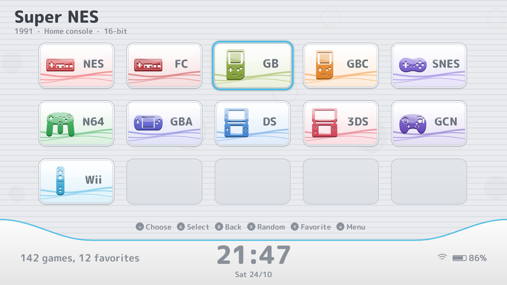
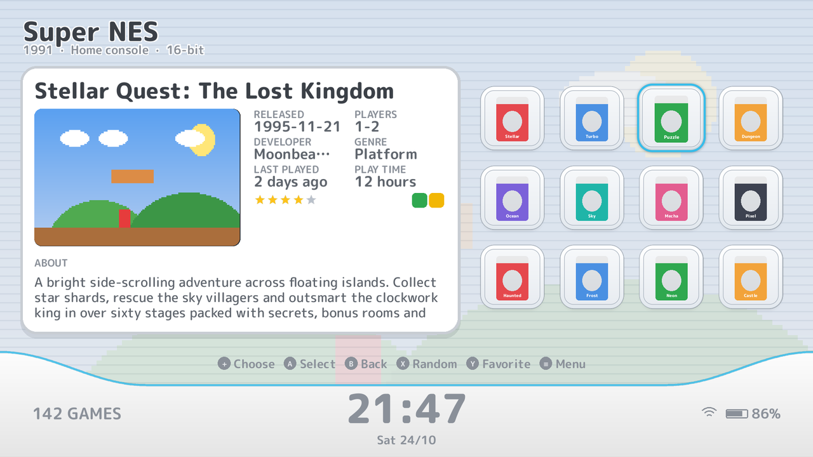
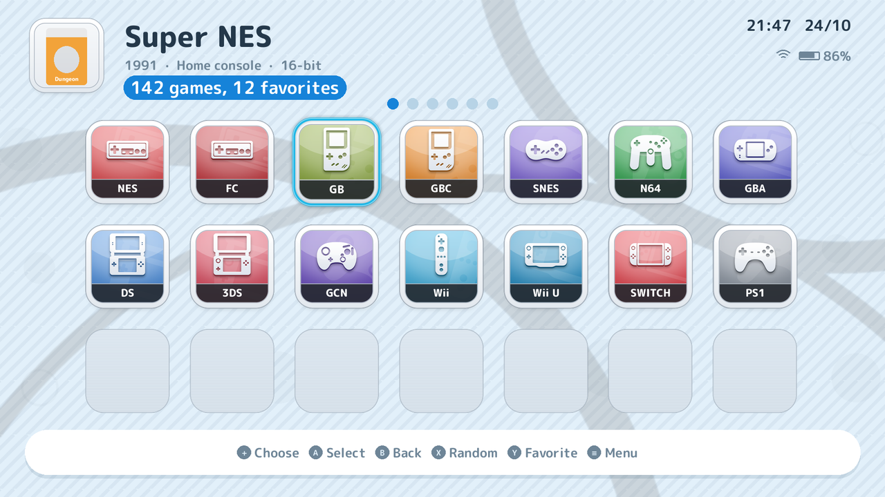
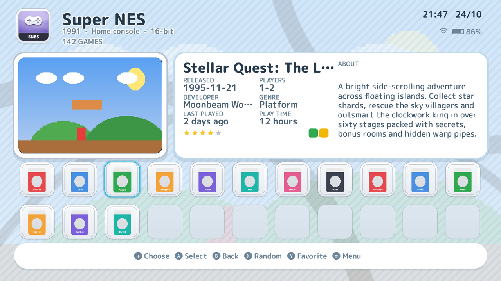
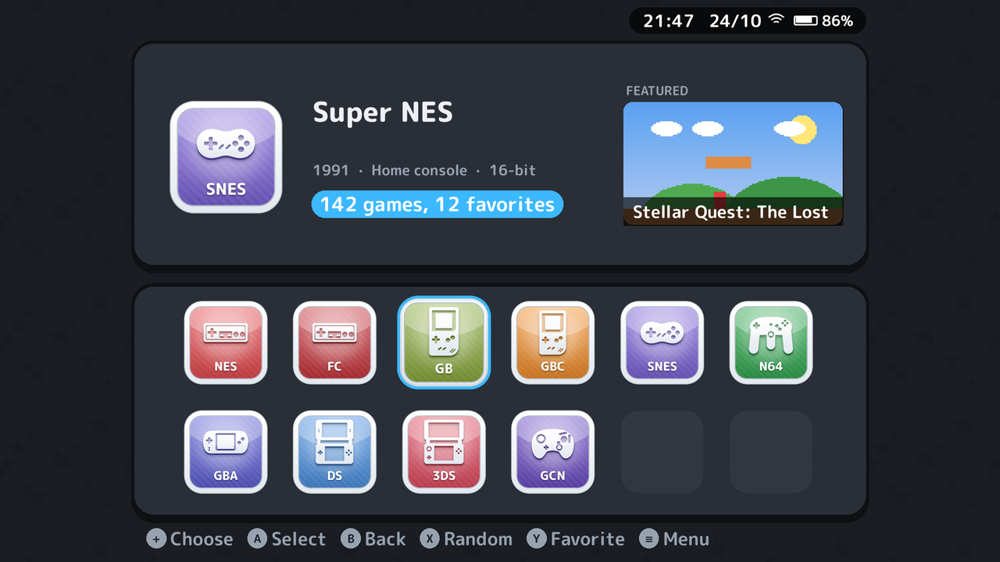
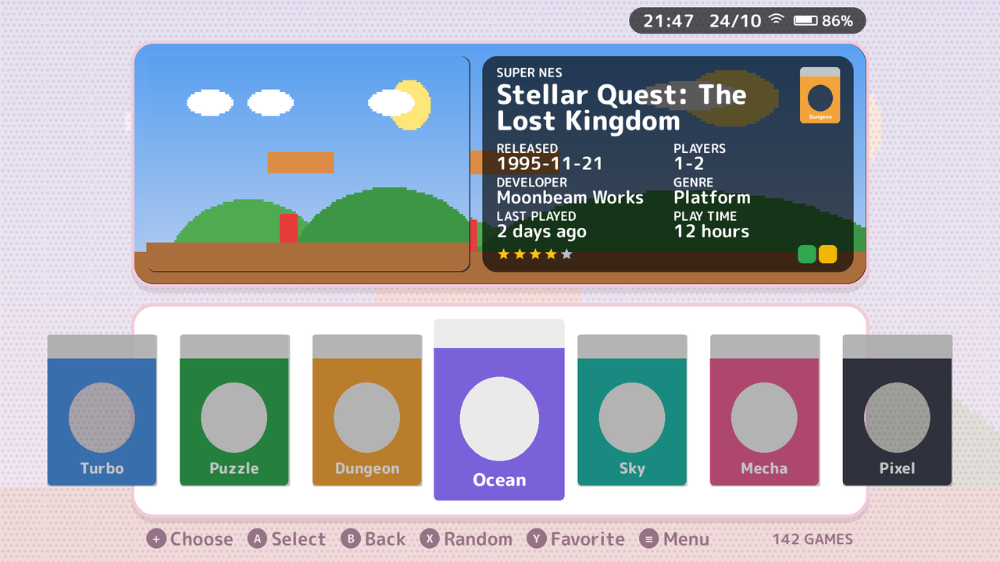

# esdeii

A console-menu style theme pack for [ES-DE](https://es-de.org). Four looks,
14 colour schemes, icons for all 197 ES-DE systems and its own soft UI
sounds. Made for ES-DE on Android, but works everywhere ES-DE runs.

> **This pack is vibecoded** — it was made with an AI assistant (Claude) and
> tested by me. If you don't like AI-made stuff, feel free to skip it.

*Previews are mock-ups with placeholder art, not real screenshots.*

## Install

1. Download **esdeii.zip** from the
   [latest release](https://github.com/dovyyyyy/esdeii/releases/latest) and unzip it.
2. Copy the **esdeii** folder into `ES-DE/themes/`
   (on Android usually `Internal storage/ES-DE/themes/`).
3. Restart ES-DE and pick **ESDEII** in *Menu → UI Settings → Theme*.

## Options (Menu → UI Settings)

- **Theme variant** — the look (**Channels**, **Home**, **Dual Grid**,
  **Dual Row**), games as a **Grid**, **Shelf** or **List**, and box art or
  **3D** boxes.
- **Color scheme** — 14 schemes, including light / dark with an accent
  colour that matches each console.
- **Font size**, **transitions** (*Smooth* or *Snappy* for slow devices)
  and every common **aspect ratio** from 4:3 to 21:9.

For the best result, scrape box art (or 3D boxes), screenshots, videos,
marquees and fan art.

## Building it yourself

Everything is generated by the Python scripts in `tools/`:
`python3 tools/build.py .  <OFL.txt>` (needs Pillow, NumPy,
SciPy and fontTools).

## Credits

M PLUS Rounded 1c font under the SIL Open Font License. All icons, artwork
and sounds were made for this theme. Not affiliated with any console maker.
