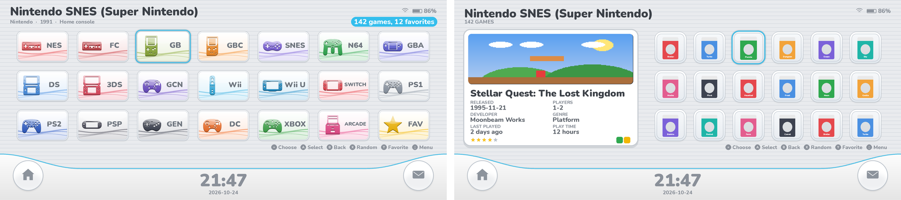
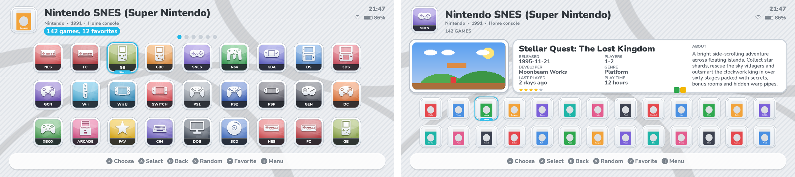

# esdeii — three console-menu themes for ES-DE

Three themes in one download, each with its own look, icons and sounds:

| Theme | Look | Sounds |
|---|---|---|
| **ESDEII** | living-room console menu: wall of wide channel tiles, curved clock bar | clicks and bell dings |
| **ESDEIIU** | tablet console home screen: framed tiles with a Start cursor, dock | pops and marimba |
| **ESDE3DS** | dual-screen handheld: two screens, hinge, row of glossy icons | soft chimes |

### ESDEII

### ESDEIIU

### ESDE3DS

*(Previews are mockups, not real ES-DE screenshots.)*

## Install (Android)

1. Download the latest version:
   https://github.com/dovyyyyy/esdeii/archive/refs/heads/main.zip
2. Unzip it and copy the folders **esdeii**, **esdeiiu** and **esde3ds** into
   the `themes` folder inside your ES-DE data folder, e.g.
   `Internal storage/ES-DE/themes/`. (You only need the ones you want.)
3. Restart ES-DE, open **Menu → UI Settings → Theme** and pick
   **ESDEII**, **ESDEIIU** or **ESDE3DS**.

To update, download again and replace the folders.

## Customisation (Menu → UI Settings)

- **Theme variant**: how games are shown — icon grid, game list or cover
  shelf. ESDEIIU and ESDE3DS also let you pick the icon style
  (Plaza, Glossy, Channel).
- **Theme color scheme**: 13 schemes (Silver Menu, Cloud White, Ice White,
  Cosmo Black, Flame Red, Aqua Blue, Mint Green, Lavender, Sunset Orange,
  Sakura Pink, Midnight Blue, Retro Pocket) plus **Light / Dark + system
  colours**, where the accent matches each console.
- **Theme font size**: small, medium, large.
- **Theme transitions**: slide, fade or instant.
- **Theme aspect ratio**: leave on Automatic (16:9, 16:10, 3:2, 4:3, 5:3,
  5:4, 8:7, 19.5:9, 20:9 and 21:9 are included).
- Navigation sounds can be switched off in ES-DE's **Sound settings**.

## Features

- System info line: maker, release year and type for every console.
- **Jump back in** (ESDE3DS): your three most recently played games.
- **Featured game**: a random game from the system.
- Game details: release date, players, developer, genre, last played, play
  time, rating, badges and a scrolling description.
- Game videos on the main screen; if a game has no screenshot (for example
  Android apps), its icon/cover is shown there instead.
- Clock, date, battery and Wi-Fi.

## Background music

The `music` folder has three original tracks and setup steps for playing
them in ES-DE with a toggle — see [music/README.md](music/README.md).

## Media used

- Grids, shelves and "Jump back in" use **box covers**.
- The main screen uses the **screenshot**, then title screen, then miximage,
  then the cover, plus the game **video**.

## Changing things

- System icons live in each theme's `systems/` folder, named after the ES-DE
  system (`snes.png`, `n3ds.png` ...). Replace any with your own PNG of the
  same size.
- Everything is generated by `tools/build.py` (layouts in `tools/layouts.py`,
  icons in `tools/icons.py` and `tools/shapes.py`, sounds and music in
  `tools/audio.py`).

## Credits

Nunito font by Vernon Adams et al., SIL Open Font License
(`assets/fonts/OFL.txt`). Icons, artwork, sounds and music were made for
these themes. Not affiliated with any console maker.
