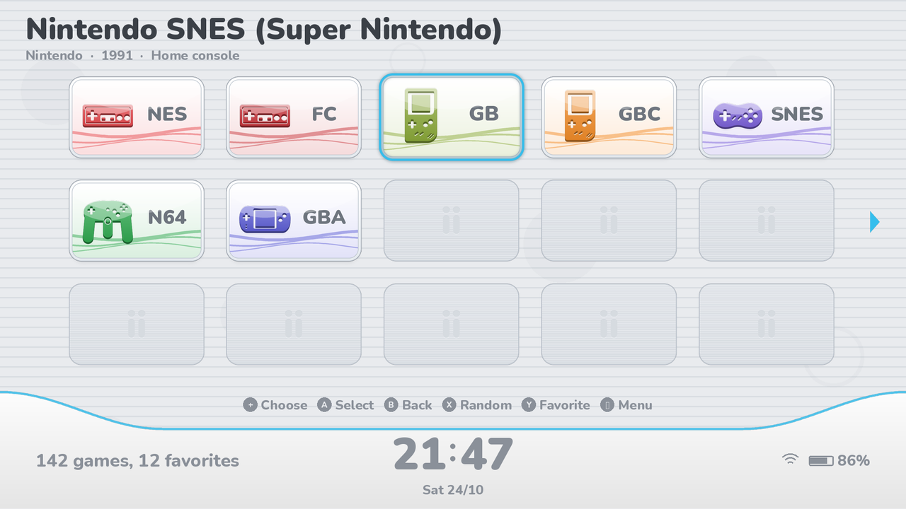
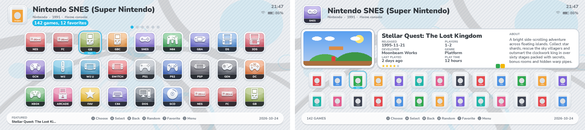
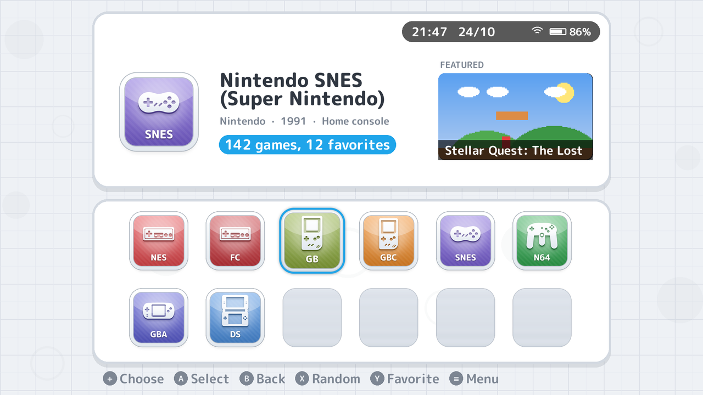
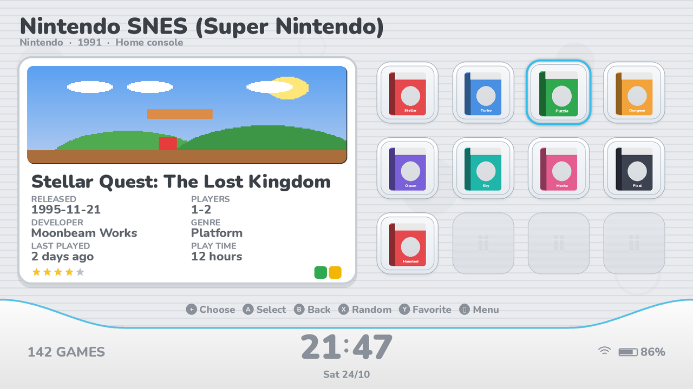

# esdeii — console-menu theme for ES-DE

One theme, four looks. Pick them in **Menu → UI Settings → Theme variant**.

| Look | What it is |
|---|---|
| **Channels** | wide channel tiles with empty slots and a curved clock bar with a big clock |
| **Home** | framed square tiles with a glowing cursor, a big video screen and a dock |
| **Dual Grid** | two screens: game artwork on top, systems in a grid of icons below |
| **Dual Row** | two screens: game artwork on top, systems in a row |

### Channels

### Home

### Dual

### 3D boxes in the game grid

*(Previews are mockups, not real ES-DE screenshots.)*

## Install (Android)

1. Download the latest version:
   https://github.com/dovyyyyy/esdeii/archive/refs/heads/main.zip
2. Unzip it and copy the **esdeii** folder into the `themes` folder inside
   your ES-DE data folder, e.g. `Internal storage/ES-DE/themes/`.
   **Delete any old `esde3ds` or `esdeiiu` folders** — the dual-screen look
   is now part of esdeii.
3. Restart ES-DE, open **Menu → UI Settings → Theme** and pick **ESDEII**.

To update, download again and replace the folder.

## Customisation (Menu → UI Settings)

- **Theme variant** — look · how games are shown, plus **3D** for 3D boxes,
  for example *Channels · Grid · 3D*:
  - looks: **Channels**, **Home**, **Dual Grid**, **Dual Row**;
  - games as a **Grid** of icons, a **Shelf** of covers or a **List**;
  - **box art**, or **3D boxes** with *· 3D*. Each falls back to
    the other, so games scraped with only 3D boxes (or only covers) still
    show their art.
- **Theme color scheme** — Silver Menu, Cloud White, Ice White, Cosmo Black,
  Flame Red, Aqua Blue, Mint Green, Lavender, Sunset Orange, Sakura Pink,
  Midnight Blue, Retro Pocket, plus **Light / Dark + system colours**
  where the accent matches each console. In the dual-screen look each scheme
  has its own background pattern.
- **Theme font size** — extra small to extra large.
- **Theme transitions** — *Smooth* (default: pages glide in and out when you
  open a system or go back, while the clock bar, dock and status pill stay
  put under the clock, battery and button prompts) or *Snappy* (instant).
  ES-DE always draws the clock, battery and button prompts on top of
  everything and never moves them, so the theme keeps the surfaces under
  them still instead of sliding them away. On Channels the game count sits
  on the left of the clock bar and stays there with it, switching to the new
  numbers; in the Dual looks the clock sits in a strip above the two
  screens, so the screens slide away underneath it. Everything else slides
  with the page in both directions.
- **Theme aspect ratio** — leave on Automatic (16:9, 16:10, 3:2, 4:3, 5:3,
  5:4, 8:7, 19.5:9, 20:9 and 21:9 are included).
- Navigation sounds can be turned off in ES-DE's **Sound settings**.

## Sounds

One soft, rounded family of sounds, in the spirit of a tablet console's home
menu with a touch of phone-UI polish. Everything is built from the same three
pieces - a felt-soft tap, a warm "bloop" that settles onto its note and a
gentle air swell - in one key, through the same small warm room, with no
harsh clicks or hiss, and levelled to the same loudness. Moving the cursor
always makes the same quiet tap; opening something plays two warm notes going
up, going back plays them going down, favouriting sparkles up four notes, and
starting a game rises into a soft open chord.

## Features

- Softly drifting bubbles in the background, tinted with your colour scheme.
  They only float in completely free space, never near the clock, date,
  battery or button prompts and never behind any panel, text or games (so on
  layouts that fill the screen there are fewer of them, or none), and never
  in the middle of the bottom of the screen. Each one glides slowly out to one
  side, back through the middle to the other side and back again, in an
  endless loop (when ES-DE restarts it, it only moves back a little).
- A few bubbles also float **behind the systems** you choose from (Channels and
  Home), in the gaps between the icons; in Dual Grid they float on the clean
  top screen instead, never near the console icons (Dual Row has none there). The game lists
  have no bubbles, so nothing moves behind the game details.
- Headers over the game artwork (system name and info) have a thin
  outline so they stay readable on any custom art.
- Faint artwork of the selected game (fan art, else the screenshot) behind
  the game list, fading in as you move. The system list never shows game
  artwork.
- Rounded console-style lettering (M PLUS Rounded 1c).
- **Artwork top screen** (Dual looks, inspired by iiSU and Cocoon): the top
  screen is filled edge to edge with the game's fan art or screenshot; a big
  screen with the screenshot and video on the left and a dark glass card with
  the system, title, a small box art and the details on the right fill it
  between them. In the system list the top screen
  shows the system plus a framed **Featured** game (a picture in a frame, not
  a background).
- **Status pills**: clock, date and battery on rounded pills (Dual and Home
  looks; in the Dual looks above the screens), and the button prompts on a
  pill in the Dual looks.
- **Empty slots** fill the rest of every grid, like the blank channels on
  a console menu (plain, without any logo).
- Descriptions and long names scroll at half speed with a pause at the
  start, so they are easy to read.
  They are tiny, so they cost almost nothing to draw.
- The clock, date and battery hide while the ES-DE menu is open.
- Icons for all 197 systems ES-DE supports, each drawn after its real
  controller or console.
- System info line: maker, release year and type for every console.
- Game count, clock, date, battery and Wi-Fi.
- **Featured game**: a random game from the selected system.
- Game details: release date, players, developer, genre, last played, play
  time, rating, badges and a scrolling description.
- Game videos (start after a moment), with the scraped **game logo** in the
  corner. Every video screen is about 3:2 - between the 4:3 and 16:9 shapes
  of game videos - so videos fill it with no black borders and only a thin
  edge trimmed.
- Games without a screenshot (for example Android apps) show their box art
  instead.

## Performance

- The drifting bubbles are light: instead of one full-screen animation that
  the phone redrew every frame, each bubble is a small, short animation.
  ES-DE draws their frames once, keeps them in memory and just replays them,
  so they barely cost anything after the first loop.
- On a slow device pick the *Snappy* transition profile: it switches views
  instantly.
- The font only contains Latin, Greek, Cyrillic and kana, so it stays small;
  other scripts (e.g. kanji) use ES-DE's built-in fallback fonts.
- Every layout is checked against ES-DE's theme reference
  (`tools/validate.py`), so ES-DE doesn't spend time logging bad properties.

## Media used

- Grids and shelves use **box art** or **3D boxes**
  (your choice, each falling back to the other).
- The game screen uses the **screenshot**, then title screen, then
  miximage, plus the game **video** and **marquee** (logo).
- The faint backdrop uses **fan art**, then the **screenshot**.

## Changing things

- System icons live in `esdeii/systems/<style>/`, named after the ES-DE
  system (`snes.png`, `n3ds.png` ...). Replace any with your own PNG of the
  same size.
- Everything is generated by `tools/build.py` (layouts in `tools/layouts.py`,
  icons in `tools/icons.py` and `tools/shapes.py`, sounds in
  `tools/audio.py`, other artwork and the small Lottie animations in `tools/themeart.py`).
  Rebuild with `python3 tools/build.py .  <OFL.txt> [cache]`, where
  the font folder holds the M PLUS Rounded 1c TTFs from
  [Google Fonts](https://github.com/google/fonts/tree/main/ofl/mplusrounded1c)
  (if the folder doesn't exist it reuses the fonts already in the theme).

## Credits

M PLUS Rounded 1c font by the M+ and Rounded M+ Project Authors, SIL Open
Font License (`assets/fonts/OFL.txt`). Icons, artwork and sounds were made for these
themes. Not affiliated with any console maker.
