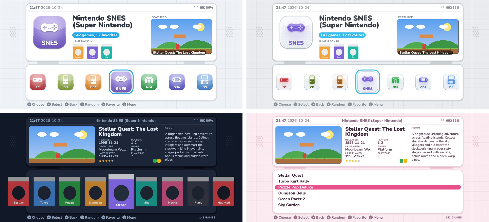

# esdeii — a dual-screen theme for ES-DE

A DS / 3DS-inspired theme: two rounded "screens" joined by a hinge, a
graph-paper background and speaker grilles beside the top screen, with
system icons in your choice of 3DS, Wii or Wii U style.

*(Preview is a mockup, not a real ES-DE screenshot.)*

## Install (Android)

1. Download this repo (**Code → Download ZIP**) and unzip it, or `git clone` it.
2. Put the folder into the `themes` folder inside your ES-DE data folder
   (the one you picked during ES-DE setup), e.g.
   `Internal storage/ES-DE/themes/esdeii`. If it unzips as `esdeii-main`,
   that's fine too.
3. Restart ES-DE, open **Menu → UI Settings → Theme** and pick **ESDEII**.

To update, replace the folder with a fresh download (or `git pull`).

## Customisation (Menu → UI Settings)

**Theme variant** — pick an icon style and a game layout:

| Icon style | Look |
|---|---|
| 3DS | glossy colour tiles with white art |
| Wii | white "channel" tiles with coloured art |
| Wii U | bold flat tiles with a white name band |

| Game layout | Look |
|---|---|
| Icon grid | 2-row grid of box covers (3DS HOME menu) |
| Game list | text list with a highlight pill (DS menu) |
| Cover shelf | big scrolling row of box covers (Wii U) |

**Theme color scheme** — Ice White, Cosmo Black, Wii Menu, Flame Red,
Aqua Blue, Mint Green, Lavender, Sunset Orange, Sakura Pink, Midnight Blue,
Retro DMG, plus **Ice White / Cosmo Black + system colours**, where the
accent colour changes to match each console's icon.

**Theme font size** — small, medium, large.

**Theme transitions** — esdeii slide, fade or instant.

**Theme aspect ratio** — leave on Automatic. Layouts are included for
16:9, 16:10, 3:2, 4:3, 5:3, 5:4, 8:7, 19.5:9, 20:9 and 21:9.

Turn on **Display clock** and the system status indicators to fill the
status bar.

## Features

- **Jump back in**: the three games you played most recently in each system,
  shown as covers on the system screen.
- **Featured game**: a random game from the system with its screenshot
  (wide screens).
- Game details: release date, players, developer, genre, last played,
  play time, rating, badges and a scrolling description.
- Game videos play on the top screen after a short delay.
- Clock and date, battery and Wi-Fi in a 3DS-style status bar.
- Custom chime navigation sounds.

## Media used

- Grid, shelf and "Jump back in" use **box covers**; games without one show
  their name.
- The top screen uses the **screenshot**, then title screen, then miximage,
  and the game **video**.

## Changing things

- System icons live in `systems/3ds`, `systems/wii` and `systems/wiiu`,
  named after the ES-DE system (`snes.png`, `n3ds.png` ...). Replace any with
  your own 360x360 PNG. Systems without a file get a coloured tile with
  their name.
- Colour schemes are at the top of `theme.xml`; per-system accent colours
  are in `systemcolors/`.
- `layouts/` is generated. To change a layout, edit `tools/make_xml.py` and
  run `python3 tools/make_xml.py .` from the repo root.
  `tools/make_assets.py` regenerates icons, graphics and sounds.

## Credits

Nunito font by Vernon Adams et al., SIL Open Font License
(`assets/fonts/OFL.txt`). Icons, sounds and graphics were made for this
theme. Not affiliated with any console maker.
