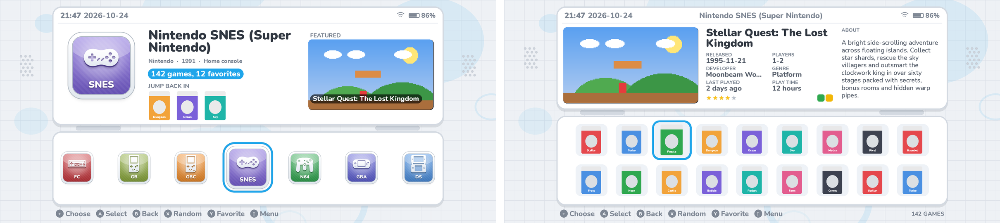

# esdeii — console-menu themes for ES-DE

Two themes in one download:

| Theme | Look | Sounds |
|---|---|---|
| **ESDEII** | console menu style, with two looks: a **Channel wall** of wide tiles above a curved clock bar, or a **Home screen** of framed tiles with a Start cursor and a dock | crisp clicks, wooden tocks and glassy dings |
| **ESDE3DS** | dual-screen handheld: two screens, hinge, row of glossy icons | soft chimes |

### ESDEII — Channel wall

### ESDEII — Home screen

### ESDE3DS

*(Previews are mockups, not real ES-DE screenshots.)*

## Install (Android)

1. Download the latest version:
   https://github.com/dovyyyyy/esdeii/archive/refs/heads/main.zip
2. Unzip it and copy the **esdeii** and/or **esde3ds** folders into the
   `themes` folder inside your ES-DE data folder, e.g.
   `Internal storage/ES-DE/themes/`.
   If you installed an older version, delete the old `esdeiiu` folder.
3. Restart ES-DE, open **Menu → UI Settings → Theme** and pick
   **ESDEII** or **ESDE3DS**.

To update, download again and replace the folders.

## Customisation (Menu → UI Settings)

- **Theme variant** — the look and how games are shown:
  - ESDEII: *Channel wall*, *Home screen* or *Home screen, glossy icons*,
    each with an icon grid, game list or cover shelf.
  - ESDE3DS: Glossy, Channel or Plaza icons, each with an icon grid, game
    list or cover shelf.
- **Theme color scheme** — Silver Menu, Cloud White, Ice White, Cosmo Black,
  Flame Red, Aqua Blue, Mint Green, Lavender, Sunset Orange, Sakura Pink,
  Midnight Blue, Retro Pocket, plus **Light / Dark + system colours**
  where the accent matches each console.
- **Theme font size** — small, medium, large.
- **Theme transitions** — slide, fade or instant.
- **Theme aspect ratio** — leave on Automatic (16:9, 16:10, 3:2, 4:3, 5:3,
  5:4, 8:7, 19.5:9, 20:9 and 21:9 are included).
- Navigation sounds can be turned off in ES-DE's **Sound settings**.

## Features

- Slowly drifting bubbles in the background, tinted with your colour scheme.
- System info line: maker, release year and type for every console.
- Game count, clock, date, battery and Wi-Fi.
- **Featured game**: a random game from the selected system.
- **Jump back in** (ESDE3DS): your three most recently played games.
- Game details: release date, players, developer, genre, last played, play
  time, rating, badges and a scrolling description.
- Game videos, with the scraped **game logo** shown in the corner.
- Games without a screenshot (for example Android apps) show their
  icon/cover instead.

## Media used

- Grids, shelves and "Jump back in" use **box covers**.
- The main screen uses the **screenshot**, then title screen, then miximage,
  then the cover, plus the game **video** and **marquee** (logo).

## Changing things

- System icons live in each theme's `systems/` folder, named after the ES-DE
  system (`snes.png`, `n3ds.png` ...). Replace any with your own PNG of the
  same size.
- Everything is generated by `tools/build.py` (layouts in `tools/layouts.py`,
  icons in `tools/icons.py` and `tools/shapes.py`, sounds in
  `tools/audio.py`, other artwork in `tools/themeart.py`).

## Credits

Nunito font by Vernon Adams et al., SIL Open Font License
(`assets/fonts/OFL.txt`). Icons, artwork and sounds were made for these
themes. Not affiliated with any console maker.
